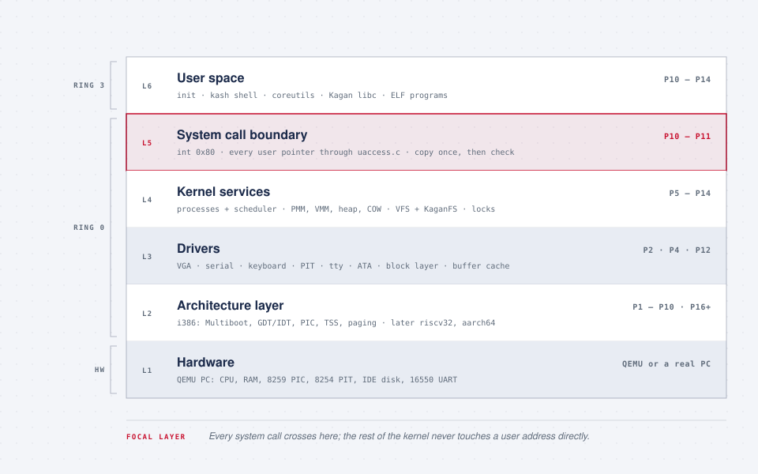
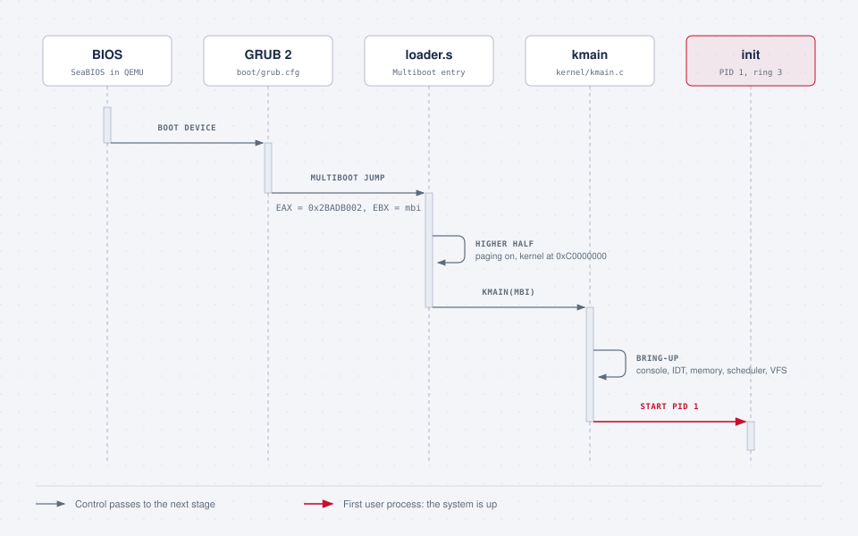
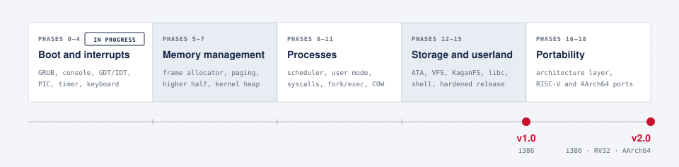

<div align="center">


<br/>

[](LICENSE)
[](#project-status)
[](#supported-platforms)
[](#coding-conventions)
[](docs/README.md)
[](https://github.com/hikmethankolay/kagan-os/commits/main)

**A monolithic, UNIX-like kernel and userland written from scratch in C and assembly,
targeting 32-bit x86 first and RISC-V and AArch64 after.**

[Architecture](#architecture) · [Building](#building) · [Roadmap](#roadmap) · [Design documents](docs/README.md) · [Security model](#security-model)

</div>

---

## Overview

Kagan is a small UNIX-like operating system. It boots through GRUB, runs preemptive multitasking with a separate
address space per process, loads ELF programs from its own on-disk file system, and provides a POSIX-flavoured system
call interface, a C library and a shell with pipes, redirection and job control. Every part of it, from the boot
stub to the shell, is written for this project; nothing is taken from an existing kernel.

The first release targets IA-32 PCs. A second release moves everything that depends on the processor behind one
architecture interface and runs the same kernel, C library and file-system image on 32-bit RISC-V and 64-bit ARM.

**Design goals**

- **Small and readable.** A monolithic kernel with a modular source tree and a short path from a system call to the
  code that serves it. Assembly only where C cannot work.
- **Correct at the protection boundary.** Every user pointer goes through one file, every system call has a
  documented validation contract, and every claim about isolation is backed by a negative test or a fuzzer.
- **Portable by construction.** Generic code never sees the CPU; firmware differences end at one boot-information
  structure filled from Multiboot or a devicetree.
- **Compatible where it costs nothing.** Linux i386 system call numbers on every architecture, and an on-disk format
  (MINIX V3) that Linux's `mkfs.minix` and `fsck.minix` create and check.
- **Tested at every step.** Each phase ends with exit criteria that run headless in QEMU and in CI.

## Project status

> [!NOTE]
> Kagan is in **pre-alpha**. The design, the full development plan and the build environment are in place; the
> kernel is being implemented phase by phase and does not boot yet. Expect the tree to fill in quickly.

<!-- Keep this block in sync with the roadmap table below. -->
| | |
|---|---|
| **Current phase** | 0 — Foundations and toolchain |
| **Next milestone** | Verified cross toolchain, source skeleton, tested support library |
| **Release targets** | `v1.0` complete system on i386 (end of Phase 15) · `v2.0` the same system on RV32 and AArch64 (end of Phase 18) |
| **Languages** | C (gnu11), NASM (Intel syntax), GNU as for the ports |
| **License** | [MIT](LICENSE) |

## Contents

- [Features](#features)
- [Supported platforms](#supported-platforms)
- [Architecture](#architecture)
- [Security model](#security-model)
- [Building](#building)
- [Running and debugging](#running-and-debugging)
- [Testing](#testing)
- [Roadmap](#roadmap)
- [Documentation](#documentation)
- [Repository layout](#repository-layout)
- [Contributing](#contributing)
- [Reporting security issues](#reporting-security-issues)
- [License](#license)

---

## Features

Planned for `v1.0`, with the phase that delivers each part.

| Area | Features | Phase |
|---|---|:---:|
| **Boot** | Multiboot 1 kernel loaded by GRUB 2 (bootable ISO) or `qemu -kernel`; higher-half kernel linked at `0xC0100000` | 1, 6 |
| **Console and diagnostics** | VGA text and 16550 serial consoles, format-checked `kprintf` with log levels and a `dmesg` ring buffer, `panic`/`ASSERT`, a register dump for every CPU exception, symbolised backtraces | 2, 3, 15 |
| **Interrupts and time** | GDT and IDT, 32 exception handlers, 8259 PIC remapped to vectors 32–47, 100 Hz PIT with `sleep_ms`, PS/2 keyboard with an optional Turkish Q layout | 3, 4 |
| **Physical memory** | Validated Multiboot memory map, buddy page-frame allocator, per-frame reference counts | 5, 11 |
| **Virtual memory** | Two-level paging, 512 MiB direct map, read-only kernel text and rodata, a VMM API, decoded page-fault reports | 6 |
| **Kernel heap** | Slab caches up to 2 KiB and a first-fit heap above, with integrity checks and allocation-failure injection | 7 |
| **Processes** | Kernel threads with guarded stacks, per-task FPU state, a preemptive round-robin scheduler (optional CFS-style), idle task and reaping | 8 |
| **Synchronisation** | Nesting interrupt control, spinlocks, wait queues, mutexes, semaphores, condition variables, saturating `refcount_t`, a lock order checked at run time | 9 |
| **User mode** | Ring 3 with one page directory per process, a validating ELF loader, checked user-memory access, stack protector | 10 |
| **Process model** | `fork` with copy-on-write, `execve` with `argv`/`envp`, `waitpid`, zombies and reparenting, lazy `brk`, growable stacks, signals, `init` as PID 1 | 11 |
| **Storage** | ATA PIO driver (polled and interrupt-driven), block layer, validated MBR partitions, RAM disk, write-back buffer cache with LRU | 12 |
| **File systems** | VFS with mount points, 64 descriptors per process with close-on-exec, ustar root archive, `devfs`, and **KaganFS**, a writable MINIX V3 file system that rejects corrupted images | 13 |
| **Userland** | Kagan libc (`errno`, strings, `malloc`, buffered `stdio`), pipes, a terminal line discipline, resource limits | 14 |
| **Shell and utilities** | `kash` with pipelines, redirection, background jobs, quoting and `PATH` lookup; `ls`, `cat`, `cp`, `mv`, `rm`, `mkdir`, `ps`, `kill`, `wc`, `hexdump` and more | 14 |
| **Security** | Users and groups, file and device permissions, sessions and terminal ownership, `login`; see [Security model](#security-model) | 10–15 |
| **Release engineering** | Benchmark suite, `make release`, reproducible builds checked by hash, `SHA256SUMS`, signed tags | 15 |

```text
kagan@os:/$ echo merhaba | wc -c
8
kagan@os:/$ ls /bin > /mnt/list.txt
kagan@os:/$ cat < /mnt/list.txt
...
kagan@os:/$ sleep 5 &
kagan@os:/$
```

## Supported platforms

All three targets run the same generic kernel, the same Kagan libc and the same KaganFS image. Real hardware is
supported after the emulated target works.

| | **i386** (`v1.0`) | **RV32** (`v2.0`) | **AArch64** (`v2.0`) |
|---|---|---|---|
| **Processor** | IA-32, ring 0 / ring 3 | `rv32imac`, S-mode / U-mode | ARMv8-A, EL1 / EL0 |
| **Machine** | `qemu-system-i386`, legacy-BIOS PCs | `qemu-system-riscv32 -machine virt`; a custom RV32IMC core | `qemu-system-aarch64 -machine virt`; Raspberry Pi 4 |
| **Firmware and discovery** | BIOS + GRUB, Multiboot | OpenSBI (M-mode), devicetree | QEMU or Pi firmware, devicetree |
| **System call trap** | `int 0x80` (number in `EAX`) | `ecall` (number in `a7`) | `svc #0` (number in `x8`) |
| **Interrupts and timer** | 8259 PIC, 8254 PIT | PLIC, SBI timer | GICv2, generic timer |
| **Paging** | Two-level, kernel at `0xC0000000` | Sv32, kernel at `0xC0000000` | 4 KiB granule, 39-bit VA, kernel in `TTBR1` |
| **Memory protection** | Read-only kernel text (32-bit paging has no NX) | W^X via PTE R/W/X; `SUM` only during user copies | W^X via `PXN`/`UXN`; optional PAN |
| **Console and disk** | VGA, 16550, ATA | 16550 (MMIO), virtio-blk | PL011, virtio-blk |

---

## Architecture

### Layers

<picture>
  <source media="(prefers-color-scheme: dark)" srcset="docs/assets/architecture-dark.svg">
  
</picture>

The kernel is monolithic: drivers, the file system and the scheduler run in ring 0 and call each other directly.
From `v2.0` the i386 layer is one of three backends behind `include/arch.h`, next to `kernel/arch/riscv32` and
`kernel/arch/aarch64`; the generic kernel above it does not change.

### Boot sequence

<picture>
  <source media="(prefers-color-scheme: dark)" srcset="docs/assets/boot-dark.svg">
  
</picture>

<details>
<summary><b>Boot sequence in detail</b></summary>

1. **BIOS** (SeaBIOS in QEMU) finds a bootable device and hands control to GRUB.
2. **GRUB 2** reads `boot/grub.cfg`, loads `kernel.elf` at physical 1 MiB together with its modules (user programs,
   the root archive, the symbol table), and jumps to the entry point with `EAX = 0x2BADB002` and `EBX` pointing at the
   Multiboot information structure.
3. **`boot/loader.s`** carries the Multiboot header. Running at physical addresses, it installs a boot page
   directory that maps 0–4 MiB at 0 (temporarily) and 0–512 MiB at `0xC0000000`, enables `CR4.PSE`, `CR0.PG` and
   `CR0.WP`, jumps into the higher half, drops the identity mapping, switches to its kernel stack and calls
   `kmain(magic, mbi)`.
4. **`kmain`** brings the system up in dependency order: consoles, GDT and IDT, PIC, timer and keyboard, memory map
   and frame allocator, paging, heap, scheduler, TSS and system calls, block devices, file systems.
5. **`init`** (PID 1) opens `/dev/tty` as descriptors 0–2, runs `login` and the shell, and reaps orphans.

With the kernel command line `test`, `kmain` runs every in-kernel test suite instead and exits QEMU with the result.

</details>

### Virtual memory layout (i386)

A 3 GiB / 1 GiB split. The kernel half is shared by every page directory, so interrupts and system calls always find
the kernel mapped.

| Virtual range | Size | Contents |
|---|---|---|
| `0x00000000`–`0x003FFFFF` | 4 MiB | Never mapped: `NULL` and small offsets fault, and the ELF loader refuses segments here |
| `0x00400000`– | | Program image (`.text`, `.rodata`, `.data`, `.bss`) |
| (above the image) | | User heap, grown by `brk` and faulted in on demand |
| …–`0xBFFFFFFF` | | User stack from `0xBFFFC000`, growing down on demand |
| `0xC0000000`–`0xDFFFFFFF` | 512 MiB | Direct map of physical 0–512 MiB; kernel image at `0xC0100000` (text and rodata read-only) |
| `0xE0000000`–`0xEFFFFFFF` | 256 MiB | Kernel heap |
| `0xF0000000`–`0xFFBFFFFF` | | Kernel stacks with guard pages, other kernel mappings |
| `0xFFC00000`–`0xFFFFFFFF` | 4 MiB | Reserved |

Kernel page tables above `0xE0000000` are pre-allocated so every address space sees new kernel mappings. PTE bit 9
marks copy-on-write pages, and `CR0.WP` makes the kernel obey read-only user pages.

### System call interface

The call number goes in `EAX` and up to three arguments in `EBX`, `ECX` and `EDX`; `int 0x80` enters the kernel
through a DPL-3 trap gate. Results come back in `EAX`, errors as a negative `errno` that Kagan libc converts to `-1`
plus `errno`. Every user pointer is copied through `copy_from_user`/`copy_to_user`, which check the range, the
page permissions and copy-on-write state before touching memory.

<details>
<summary><b>System calls (Linux i386 numbering)</b></summary>

| No. | Call | Phase | | No. | Call | Phase |
|---:|---|:---:|---|---:|---|:---:|
| 1 | `exit` | 10 | | 36 | `sync` | 13 |
| 2 | `fork` | 11 | | 37 | `kill` | 11 |
| 3 | `read` | 10 | | 38 | `rename` | 14 |
| 4 | `write` | 10 | | 39 | `mkdir` | 13 |
| 5 | `open` | 13 | | 41 | `dup` | 13 |
| 6 | `close` | 13 | | 42 | `pipe` | 14 |
| 7 | `waitpid` | 11 | | 45 | `brk` | 11 |
| 10 | `unlink` | 13 | | 46 | `setgid` | 15 |
| 11 | `execve` | 11 | | 47 | `getgid` | 15 |
| 12 | `chdir` | 13 | | 54 | `ioctl` | 14 |
| 19 | `lseek` | 13 | | 55 | `fcntl` | 13 |
| 20 | `getpid` | 10 | | 63 | `dup2` | 13 |
| 23 | `setuid` | 15 | | 64 | `getppid` | 11 |
| 24 | `getuid` | 15 | | 106 | `stat` | 13 |
| | | | | 108 | `fstat` | 13 |
| | | | | 141 | `getdents` | 13 |
| | | | | 158 | `sched_yield` | 10 |
| | | | | 162 | `nanosleep` (milliseconds) | 10 |
| | | | | 183 | `getcwd` | 13 |

`getprocs`, used by `ps`, has no Linux equivalent. The reference with arguments and errors is `docs/syscalls.md`; the
validation contract of each call is `docs/security/syscalls.md`.

</details>

### KaganFS on-disk format

KaganFS is the MINIX V3 file system with 1 KiB blocks, byte-compatible with Linux's `mkfs.minix -3`.

| Block(s) on an 8 MiB image | Region |
|---|---|
| 0 | Boot block (unused) |
| 1 | Superblock: inode and zone counts, bitmap sizes, first data zone, magic `0x4D5A` |
| 2 · 3 | Inode bitmap · zone bitmap |
| 4–174 | Inode table: 64-byte inodes, 16 per block |
| 175–8191 | Data zones: file contents, directories, indirect blocks |

Inodes hold seven direct, one single-indirect and one double-indirect zone pointer; directory entries are a 32-bit
inode number and a 60-byte name. The superblock is validated at mount and every inode and zone number is
bounds-checked before use, so a corrupted image is refused rather than trusted. Writes are ordered allocate →
initialise → link, so a crash leaves at worst leaked blocks, which `fsck.minix` repairs.

---

## Security model

The goal for `v1.0` is concrete: **no unprivileged program and no malformed disk image can crash or take over the
kernel**, and every claim of that kind is backed by a test. Physical attackers, the boot chain, networks, malicious
hardware and side channels are out of scope; the threat model in `docs/security/threat-model.md` records the
boundaries and the residual risks.

| Layer | Mechanism | From phase |
|---|---|:---:|
| Supply chain | GNU toolchain sources verified with `gpg`; tool versions pinned in `docs/toolchain.lock` | 0 |
| Compiler | `-Werror -Wformat=2`, format-checked logging, overflow-checked size arithmetic, stack protector | 0, 2, 10 |
| Kernel memory | Read-only text and rodata, guard pages under kernel stacks, unmapped page 0, saturating reference counts | 6, 8, 9 |
| User/kernel boundary | One `uaccess.c` for all user memory, copy-once validation, zeroed structures before copy-out, a per-call validation table | 10, 11 |
| Untrusted input | Validating ELF loader; bounds-checked partition tables, superblocks, inodes and tar headers | 10, 12, 13 |
| Isolation | Per-process address spaces, per-task FPU state, resource limits, users, groups, file and device permissions, sessions | 8–15 |
| Verification | Negative tests ("evil programs"), a seeded system call fuzzer, host fuzzing of every parser, a trap-on-UB kernel build, CI on every push | 7–15 |
| Release | Reproducible builds compared by hash, `SHA256SUMS`, signed tags | 15 |
| Ports | The same tests on RISC-V and AArch64, plus W^X; `SUM`/PAN limit user access to copy routines | 16–18 |

---

## Building

Kagan builds on **Linux, macOS and Windows (WSL2)** with a GCC cross compiler for `i686-elf`, NASM, QEMU, GDB and
GRUB. The complete guide, including editor setup, troubleshooting and the toolchains for the ports, is
**[docs/setup.md](docs/setup.md)**.

> [!NOTE]
> The top-level `Makefile` lands with the boot code in Phase 1. Until then, the steps below set up the toolchain and
> `make -C docs` builds the design documents.

### 1. Install the host tools

<details>
<summary><b>Arch Linux</b></summary>

```sh
sudo pacman -S --needed base-devel git nasm qemu-desktop gdb libisoburn mtools grub
```

`base-devel` includes what the cross compiler needs. Alternatively, install the cross toolchain from the AUR
(`i686-elf-binutils`, `i686-elf-gcc`) and skip step 2.

</details>

<details>
<summary><b>Fedora</b></summary>

```sh
sudo dnf install gcc make git nasm qemu-system-x86 qemu-img gdb xorriso mtools \
                 grub2-tools grub2-tools-extra grub2-pc-modules util-linux \
                 bison flex gmp-devel mpfr-devel libmpc-devel texinfo
```

Fedora names the GRUB tools `grub2-mkrescue` and `grub2-file`.

</details>

<details>
<summary><b>Ubuntu / Debian</b></summary>

```sh
sudo apt update
sudo apt install build-essential git curl nasm qemu-system-x86 qemu-system-gui qemu-utils gdb \
                 xorriso mtools grub-pc-bin grub-common util-linux \
                 bison flex libgmp-dev libmpfr-dev libmpc-dev texinfo
```

`grub-pc-bin` provides the BIOS modules; without it the ISO boots only on UEFI.

</details>

<details>
<summary><b>macOS (Homebrew)</b></summary>

Homebrew ships a prebuilt cross compiler, so skip step 2:

```sh
brew install i686-elf-binutils i686-elf-gcc i686-elf-grub i386-elf-gdb \
             nasm qemu xorriso mtools util-linux make coreutils gnupg
echo 'export PATH="$(brew --prefix util-linux)/sbin:$PATH"' >> ~/.zshrc
```

Use `gmake`, `i386-elf-gdb`, `i686-elf-grub-mkrescue` and `gtimeout`; see the
[macOS notes](docs/setup.md#macos).

</details>

<details>
<summary><b>Windows 10 / 11 (WSL2)</b></summary>

Build inside WSL2 with Ubuntu. From an elevated PowerShell:

```powershell
wsl --install -d Ubuntu
wsl --update
```

Then follow the Ubuntu steps inside WSL and keep the repository in the Linux file system (`~/kagan-os`), not under
`/mnt/c`. See the [WSL2 notes](docs/setup.md#windows-wsl2).

</details>

### 2. Build the cross compiler

Linux and WSL2 only. Installs into `~/opt/cross` without `sudo`; takes 20–40 minutes once.

```sh
export BINUTILS_VERSION=2.47 GCC_VERSION=16.2.0
export PREFIX="$HOME/opt/cross" TARGET=i686-elf PATH="$HOME/opt/cross/bin:$PATH"

mkdir -p ~/src && cd ~/src
curl -LO https://ftp.gnu.org/gnu/gnu-keyring.gpg && gpg --import gnu-keyring.gpg
for f in binutils/binutils-$BINUTILS_VERSION gcc/gcc-$GCC_VERSION/gcc-$GCC_VERSION; do
    curl -LO https://ftp.gnu.org/gnu/$f.tar.xz && curl -LO https://ftp.gnu.org/gnu/$f.tar.xz.sig
done
gpg --verify binutils-$BINUTILS_VERSION.tar.xz.sig binutils-$BINUTILS_VERSION.tar.xz
gpg --verify gcc-$GCC_VERSION.tar.xz.sig gcc-$GCC_VERSION.tar.xz
tar xf binutils-$BINUTILS_VERSION.tar.xz && tar xf gcc-$GCC_VERSION.tar.xz

mkdir -p build-binutils && cd build-binutils
../binutils-$BINUTILS_VERSION/configure --target=$TARGET --prefix="$PREFIX" --with-sysroot --disable-nls --disable-werror
make -j"$(nproc)" && make install

mkdir -p ../build-gcc && cd ../build-gcc
../gcc-$GCC_VERSION/configure --target=$TARGET --prefix="$PREFIX" --disable-nls --enable-languages=c --without-headers
make -j"$(nproc)" all-gcc all-target-libgcc && make install-gcc install-target-libgcc

echo 'export PATH="$HOME/opt/cross/bin:$PATH"' >> ~/.bashrc
```

> [!IMPORTANT]
> Both `gpg --verify` commands must report `Good signature` before you unpack anything. Check
> [ftp.gnu.org/gnu](https://ftp.gnu.org/gnu/) for newer versions, and see
> [section 3](docs/setup.md#3-build-the-i686-elf-cross-compiler) of the setup guide if the build fails.

### 3. Verify and build

```sh
i686-elf-gcc --version          # i686-elf-gcc (GCC) 16.2.0
nasm -v && qemu-system-i386 --version && gdb --version
git clone https://github.com/hikmethankolay/kagan-os.git && cd kagan-os
make run                        # from Phase 1
```

<details>
<summary><b>Make targets</b></summary>

| Command | What it does | Available from |
|---|---|:---:|
| `make` | Builds `build/kernel.elf` | Phase 1 |
| `make run` | Boots the kernel in QEMU with the serial console on your terminal | Phase 1 |
| `make iso` | Builds a bootable `build/kagan.iso` with GRUB | Phase 1 |
| `make debug` | Starts QEMU halted with its GDB stub and attaches GDB | Phase 1 |
| `make clean` | Removes `build/` | Phase 1 |
| `make test` | Boots a headless QEMU, runs every in-kernel test and fails on any failure | Phase 7 |
| `make test UBSAN=1` | The same, with a kernel that traps on undefined behaviour | Phase 7 |
| `make release` | Kernel, userland, root archive, KaganFS image and ISO | Phase 15 |
| `make ARCH=riscv32 …` / `ARCH=aarch64` | Any target above for another architecture (`i386` is the default) | Phase 16 |
| `make check-generic` | Compiles the generic kernel for every architecture to catch non-portable code | Phase 16 |
| `make -C docs` | Builds the design documents (PDF) | now |

Tool names that differ between platforms are listed in [setup.md, section 4](docs/setup.md#4-tool-names-on-each-platform);
the toolchains for the ports are in [section 9](docs/setup.md#9-toolchains-for-the-ports-stage-v).

</details>

---

## Running and debugging

```sh
qemu-system-i386 -kernel build/kernel.elf -serial stdio          # quick boot via QEMU's Multiboot loader
qemu-system-i386 -cdrom build/kagan.iso -serial stdio           # full BIOS → GRUB → kernel boot
```

<details>
<summary><b>More QEMU configurations</b></summary>

```sh
# Serial log to a file, 128 MiB of RAM
qemu-system-i386 -kernel build/kernel.elf -serial file:build/serial.log -m 128

# User programs as Multiboot modules
qemu-system-i386 -kernel build/kernel.elf -serial stdio -initrd "build/user/hello.elf,build/user/evil.elf"

# Scratch disk on the primary master, KaganFS on the primary slave
qemu-img create -f raw build/disk.img 64M
dd if=/dev/zero of=build/kaganfs.img bs=1024 count=32768 && mkfs.minix -3 build/kaganfs.img
qemu-system-i386 -kernel build/kernel.elf -serial stdio \
    -drive file=build/disk.img,format=raw,if=ide,index=0,media=disk \
    -drive file=build/kaganfs.img,format=raw,if=ide,index=1,media=disk

# RISC-V and AArch64 (v2.0), KaganFS on virtio-blk
qemu-system-riscv32 -machine virt -bios default -m 128M -nographic \
    -kernel build/riscv32/kernel.elf -global virtio-mmio.force-legacy=false \
    -drive if=none,format=raw,file=build/riscv32/kaganfs.img,id=hd0 \
    -device virtio-blk-device,drive=hd0,bus=virtio-mmio-bus.0
qemu-system-aarch64 -machine virt,gic-version=2 -cpu cortex-a72 -m 128M -nographic \
    -kernel build/aarch64/kernel8.img -global virtio-mmio.force-legacy=false \
    -drive if=none,format=raw,file=build/aarch64/kaganfs.img,id=hd0 -device virtio-blk-device,drive=hd0
```

With `-nographic`, press Ctrl+A then X to quit.

</details>

| Tool | Invocation | What it gives you |
|---|---|---|
| Serial log | `-serial stdio` | How far the kernel got, with every boot step logged |
| Interrupt trace | `-d int,cpu_reset -no-reboot` | Every exception with vector and registers; no silent reboot on triple fault |
| QEMU monitor | `-monitor stdio` | `info registers`, `info mem`, `info block` |
| GDB | `make debug` | Source-level debugging over QEMU's GDB stub |
| Crash and fault reports | built in | Register dump per exception; page faults decoded (address, access, mode, cause) |
| UB trap build | `make test UBSAN=1` + `addr2line` | The exact line that triggered undefined behaviour |
| Backtraces | built in (Phase 15) | Symbolised call chain in every panic |

## Testing

| Level | What runs | From phase |
|---|---|:---:|
| Host unit tests | Support library and parsers built for the host under AddressSanitizer and UBSan | 0 |
| In-kernel tests | `ktest` suites booted headless by `make test`; result reported through `isa-debug-exit` | 5, 7 |
| Continuous integration | Every push: `-Werror` build, host tests, `make test`. Nightly: UB-trap build and fuzzers | 7 |
| Failure injection | Forced allocation failures; every caller must return an error | 7 |
| Stress | Heap churn, 1000 task and fork cycles without leaks, classic concurrency problems with lock checking | 7–11 |
| Negative tests | "Evil programs" that misbehave on purpose: bad and kernel pointers, malformed ELF files, stack smashing, writes to read-only pages | 10, 11 |
| Fuzzing | Seeded, replayable system call fuzzer; libFuzzer targets for the ELF, KaganFS and tar parsers | 10–15 |
| File-system checks | `fsck.minix` on images written by Kagan, including after an unclean shutdown | 13 |
| Shell tests | `kash -c` command lines compared with expected output | 14 |
| Cross-architecture | `make check-generic`, devicetree parser tests, and the full suite on RISC-V and AArch64 | 16–18 |

---

## Roadmap

<picture>
  <source media="(prefers-color-scheme: dark)" srcset="docs/assets/roadmap-dark.svg">
  
</picture>

Development proceeds in 19 phases. Each has a design document in [`docs/pdf/`](docs/pdf/) that specifies the
subsystem, its implementation tasks with acceptance checks, and the exit criteria that close the phase.

| # | Phase | Deliverables | Design doc | Status |
|---:|---|---|:---:|:---:|
| 0 | Foundations and toolchain | Verified cross toolchain, source skeleton, tested support library, threat-model stub | [PDF](docs/pdf/phase-00-foundations.pdf) | 🔄 |
| 1 | Assembly and boot | Boot sector; Multiboot kernel booted by GRUB and QEMU | [PDF](docs/pdf/phase-01-assembly-and-boot.pdf) | ⬜ |
| 2 | Consoles and logging | VGA and serial drivers, `kprintf`, `panic`; warning-free `-Werror` build | [PDF](docs/pdf/phase-02-output-drivers.pdf) | ⬜ |
| 3 | Descriptors and exceptions | GDT, IDT, exception handlers with register dumps | [PDF](docs/pdf/phase-03-gdt-idt-exceptions.pdf) | ⬜ |
| 4 | Hardware interrupts | PIC, PIT, keyboard, kernel monitor | [PDF](docs/pdf/phase-04-hardware-interrupts.pdf) | ⬜ |
| 5 | Physical memory | Validated memory map, bitmap and buddy allocators, kernel test framework | [PDF](docs/pdf/phase-05-physical-memory.pdf) | ⬜ |
| 6 | Paging | Higher-half kernel, VMM API, fault reports, read-only kernel text | [PDF](docs/pdf/phase-06-paging-higher-half.pdf) | ⬜ |
| 7 | Kernel heap | Slab caches and heap, `make test`, CI, trap-on-UB build | [PDF](docs/pdf/phase-07-kernel-heap.pdf) | ⬜ |
| 8 | Scheduling | Kernel threads, context switch, preemptive scheduler, per-task FPU state | [PDF](docs/pdf/phase-08-processes-scheduling.pdf) | ⬜ |
| 9 | Synchronisation | Spinlocks, wait queues, mutexes, semaphores, lock-order checking | [PDF](docs/pdf/phase-09-synchronization.pdf) | ⬜ |
| 10 | User mode | Ring 3, system calls, checked user access, ELF loader, threat model | [PDF](docs/pdf/phase-10-user-mode-syscalls.pdf) | ⬜ |
| 11 | Process API | `fork`/COW, `exec`, `wait`, `brk`, signals, system call fuzzer | [PDF](docs/pdf/phase-11-process-api.pdf) | ⬜ |
| 12 | Storage | ATA driver, block layer, partitions, buffer cache | [PDF](docs/pdf/phase-12-storage-drivers.pdf) | ⬜ |
| 13 | File systems | VFS, descriptors, tar root, writable KaganFS, parser fuzzing | [PDF](docs/pdf/phase-13-file-systems.pdf) | ⬜ |
| 14 | Userland | Kagan libc, pipes, terminal, `kash`, core utilities, resource limits | [PDF](docs/pdf/phase-14-userland-shell.pdf) | ⬜ |
| 15 | Hardening and `v1.0` | Final audit, permissions and sessions, benchmarks, reproducible signed release | [PDF](docs/pdf/phase-15-hardening-release.pdf) | ⬜ |
| 16 | Portability layer | `include/arch.h`, boot information, devicetree parser, 64-bit-clean generic code | [PDF](docs/pdf/phase-16-portability-layer.pdf) | ⬜ |
| 17 | RISC-V port | RV32 on QEMU `virt`: OpenSBI, Sv32, PLIC, virtio-blk | [PDF](docs/pdf/phase-17-riscv-port.pdf) | ⬜ |
| 18 | AArch64 port and `v2.0` | EL1, GICv2, generic timer, MMU, LP64 userland | [PDF](docs/pdf/phase-18-arm-port.pdf) | ⬜ |

<details>
<summary><b>Exit criteria per phase</b></summary>

- **P0** — `i686-elf-gcc`, NASM, QEMU and GDB work; toolchain signatures verified; support library and overflow helpers pass their tests; threat-model stub written.
- **P1** — Boot sector prints a message; Multiboot kernel boots via `-kernel` and via a GRUB ISO.
- **P2** — Banner on screen, same log on the serial port, `kprintf` and `panic` tested; the kernel builds with `-Werror`.
- **P3** — GDT and IDT loaded; divide-by-zero shows a register dump; `int3` returns cleanly.
- **P4** — Timer ticks at 100 Hz; keyboard input with shift and caps; monitor commands run.
- **P5** — Memory map printed; bitmap and buddy allocators pass the tests from 16 MiB to 3 GiB of RAM.
- **P6** — Kernel runs at `0xC0000000`; null dereference produces a clean page-fault report; a write to kernel code faults.
- **P7** — Stress test passes through the slab caches; `make test` runs headless and in CI; the UB-trap build passes; allocation failures are handled.
- **P8** — Kernel threads preempt each other; `sleep` works; no leaks over 1000 task cycles; FPU state stays with its task.
- **P9** — Race demo fixed by locks; bounded buffer and dining philosophers run without deadlock; lock order checked.
- **P10** — Ring-3 program prints through `write`; malicious programs are killed or get errors while the kernel survives; malformed ELF files are rejected; every system call has a validation contract.
- **P11** — `fork`/`exec`/`wait` works; copy-on-write verified, also through `copy_to_user`; no leaks over 1000 forks; ten minutes of fuzzing without a panic.
- **P12** — Disk identified; data survives reboot; partitions detected and corrupted tables rejected; buffer cache in use.
- **P13** — Images written by Kagan pass `fsck.minix`; descriptor semantics tested; corrupted images rejected; parsers survive an hour of fuzzing.
- **P14** — Boots to the `kash` prompt; pipes, redirection and Ctrl+C work; utilities present; resource limits enforced.
- **P15** — One hour of fuzzing as an unprivileged user without a panic; permission and session tests pass; two clean builds match; `v1.0` tagged and signed.
- **P16** — Generic code free of x86; `make ARCH=i386 test` passes; generic code compiles for riscv32 and aarch64 without warnings; devicetree parser passes its tests.
- **P17** — RISC-V `virt` boots to `kash`; `make ARCH=riscv32 test` passes, negative tests included; W^X holds; KaganFS images interoperate.
- **P18** — AArch64 `virt` boots to `kash`; `make ARCH=aarch64 test` passes, negative tests included; W^X holds; one KaganFS image works on all three; `v2.0` tagged.

</details>

After `v1.0`, optional extensions are specified in Phase 15: a framebuffer console with full Turkish text, SMP,
networking (e1000/RTL8139, IPv4, UDP, minimal TCP), a 64-bit x86 port, a user-space driver experiment,
KVM acceleration and loadable kernel modules.

---

## Documentation

| Document | Contents |
|---|---|
| [Roadmap](docs/pdf/00-roadmap.pdf) | Architecture decisions, phase map, risks and the security approach across all phases |
| [Phase design documents](docs/pdf/) | One per phase: concepts, reference reading, implementation tasks with acceptance checks, failure modes, exit criteria |
| [Setup guide](docs/setup.md) | Toolchain installation and verification on every supported host, editor setup, troubleshooting |
| [Documentation index](docs/README.md) | How the LaTeX sources are organised and built (`make -C docs`) |
| [Engineering journal](docs/journal.md) | Decisions, hypotheses and debugging notes as the implementation proceeds |

<details>
<summary><b>References</b></summary>

The design follows the standard operating-systems literature and compares every subsystem with MINIX 3 and Linux:

- Arpaci-Dusseau, *Operating Systems: Three Easy Pieces* · Silberschatz et al., *Operating System Concepts*, 10th ed. ·
  Tanenbaum and Bos, *Modern Operating Systems*, 4th ed. · Tanenbaum and Woodhull, *Operating Systems: Design and
  Implementation*, 3rd ed. (MINIX 3) · Love, *Linux Kernel Development*, 3rd ed. · Billimoria, *Linux Kernel
  Programming* · Helin and Renberg, *The little book about OS development*
- [Intel 64 and IA-32 Architectures SDM, Vol. 3A](https://www.intel.com/content/www/us/en/developer/articles/technical/intel-sdm.html) ·
  [Multiboot 0.6.96](https://www.gnu.org/software/grub/manual/multiboot/multiboot.html) ·
  [OSDev Wiki](https://wiki.osdev.org) · [xv6](https://github.com/mit-pdos/xv6-public)
- [RISC-V ISA and SBI specifications](https://riscv.org/specifications/ratified/) ·
  [Arm Architecture Reference Manual](https://developer.arm.com/documentation) ·
  [Devicetree](https://www.devicetree.org/specifications/) · [Virtio](https://docs.oasis-open.org/virtio/virtio/) ·
  [xv6-riscv](https://github.com/mit-pdos/xv6-riscv)
- [NIST SP 800-218 (SSDF)](https://csrc.nist.gov/pubs/sp/800/218/final) ·
  [Linux Kernel Self-Protection](https://docs.kernel.org/security/self-protection.html) ·
  [SEI CERT C](https://wiki.sei.cmu.edu/confluence/display/c)

</details>

---

## Repository layout

```text
kagan-os/
├── boot/                 Multiboot entry (loader.s), grub.cfg
├── kernel/
│   ├── arch/             i386 · riscv32 · aarch64 backends behind include/arch.h
│   ├── mm/               physical and virtual memory, heap, fault handling
│   ├── proc/             tasks, scheduler, fork/exec, signals
│   ├── sync/             spinlocks, mutexes, semaphores, wait queues
│   ├── fs/               VFS, tarfs, KaganFS, devfs, pipes
│   ├── drivers/          consoles, keyboard, timer, tty, ATA, block layer, virtio
│   └── syscall/          system call dispatch and uaccess.c
├── lib/                  freestanding support library (strings, printf, bitmaps, FDT parser)
├── include/              kernel headers, including the lock order and the arch interface
├── user/                 Kagan libc, init, kash, utilities, negative tests, fuzzer
├── tests/                host unit tests, fuzz targets, test data
├── tools/                host-side helpers
└── docs/                 design documents (LaTeX + PDF), setup guide, security docs, diagrams
```

The tree fills in phase by phase; empty directories hold a `.gitkeep`. All build output goes to `build/` (per
architecture from `v2.0`) and stays out of Git.

---

## Contributing

Issues and suggestions are welcome, whether a bug in the code or a mistake in a design document. Please open an
[issue](https://github.com/hikmethankolay/kagan-os/issues) before a large change so the design can be discussed
against the roadmap.

### Coding conventions

<details>
<summary><b>C, assembly, kernel rules and Git</b></summary>

**C** — `-std=gnu11 -ffreestanding` with `i686-elf-gcc`; kernel flags
`-O2 -g -Wall -Wextra -Werror -Wformat=2 -Wshadow -Wvla -Wstrict-prototypes -fno-omit-frame-pointer`; link with
`-nostdlib -lgcc`. Only the freestanding headers; everything else lives in `lib/`. Hardware structures are `packed`
and size-checked with `_Static_assert`; MMIO goes through `volatile`. On `i686-elf`, `uint32_t` is `unsigned long`,
so print it with `%lx`/`%lu`. Size arithmetic uses the overflow-checked helpers in `lib/checked.h`.

**Assembly** — NASM, Intel syntax, only where C cannot work (entry, descriptor loads, interrupt stubs, context
switch, user-mode entry); cdecl, preserving `EBX`, `ESI`, `EDI`, `EBP`. The ports use preprocessed GNU as (`.S`).

**Kernel rules**
- All user memory is accessed through `uaccess.c`; copy once, then validate the copy; never hold a spinlock across
  a user copy; zero every structure before copying it out.
- Every shared structure has a documented lock; locks follow the order in `include/locks.h`.
- Fallible functions return 0 or a negative `errno`; pointer returns use `ERR_PTR`. User input never causes a panic.
- Shared objects use saturating `refcount_t`. Interrupt handlers stay short and defer work.
- Every resource has a limit; every new system call gets a validation entry and fuzzer coverage.

**Git** — small commits that build and boot; LF line endings; build output stays out of Git; every fixed security
bug gets a regression test; releases are signed tags.

</details>

## Reporting security issues

Please report vulnerabilities privately through GitHub's
[private vulnerability reporting](https://github.com/hikmethankolay/kagan-os/security/advisories/new) rather than a
public issue. Each confirmed issue is fixed together with a regression test.

## License

Kagan is released under the [MIT License](LICENSE). Copyright © 2026 Hikmethan KOLAY. The license covers the
source code and the documentation in `docs/`.
